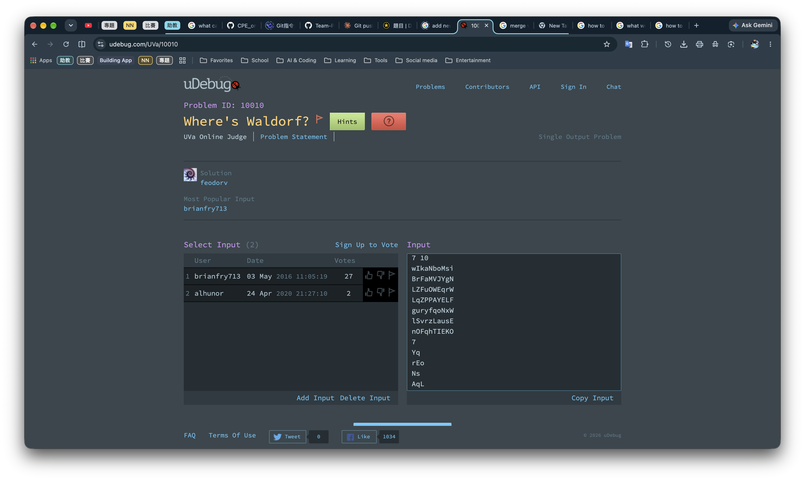
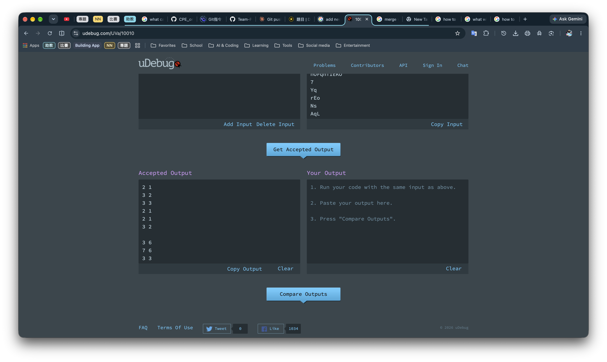

# Testing Data

> *The Testing Data are from the uDebug website: https://www.udebug.com/ .*

## Rules

**More test cases are always better but**:
- Min number of test cases for each problem: 1
- Max number of test cases for each problem: 7

**Input**: from `Input`
**Output**: from `Accepted Output`

### Exception: weekly practice problems

For the weekly practice sets the 1–7 limit does not apply:
- 15 test cases per problem, generated by us, covering the edge conditions with values close to the limits.
- Every output is confirmed by two independently written solutions; every input is checked by a validator.
- uDebug is used as a cross-check (our solution must match its `Accepted Output`), not as the source.

Details: `.agents/skills/cpe-5-testing-data/SKILL.md`, section W.

## Example

**Select Input**: they are test cases
**Input**: the input of each test case

**Accepted Output**: the output of each test case
> But you need to press the `Get Accepted Output` button to get the output.

## Example Result

[./example.md](./example.md)